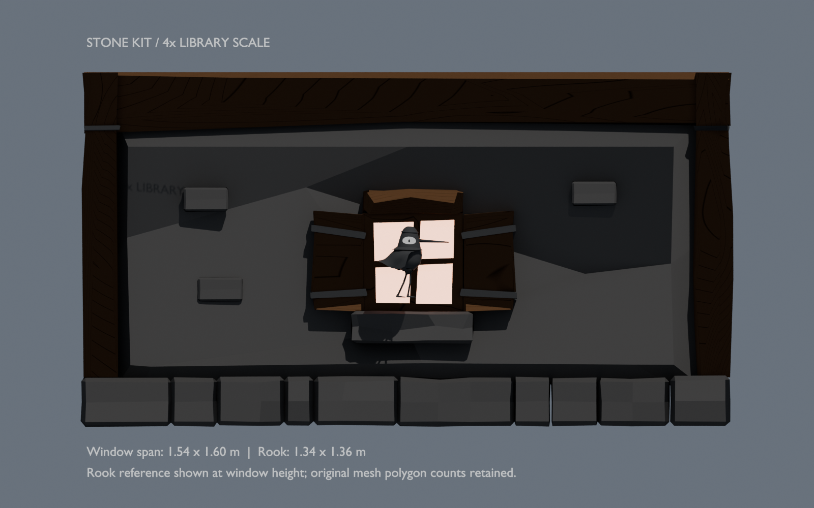

# Blender component library

Open `art/ComponentLibrary/Rook_Component_Library.blend` in Blender 5.2 or later.
It contains **53 reusable component collections** from the project, marked as
Blender assets and grouped into nine catalogs:

- Architecture: stone tiles, cobblestones, harbor walls/arch, railings, planks,
  supports, foundation, retaining wall, foundation corner, plain stone wall,
  windowed stone wall, door stone wall, plain stone corner wall and broken arch wall.
- Vegetation: both grass blocks and both tuft variations.
- Props/gameplay: both barrel wrappers, coin, cargo seal, pressure plate, prototype
  arch, hinged door, rigged bronze bell, manifest desk, vault crank and chessboard.
- Buildings: the current exported storefront and the complete Stone warehouse.
- Characters: current Rook, light player-two variant, Hound and Mouse.
- Connectors: straight, corner, T-junction, staircase and bridge.
- Rooms: harbor hall and storehouse.
- Assemblies: both existing entryway builds.
- Earlier versions: earlier Rook, Hound v1 and Mouse v1.

The file opens to **Component Overview**, with each component labeled and its
dimensions shown in metres. The overview uses collection instances; its display
offsets do not change the original asset pivots. **Asset Sources** contains the
editable master collections at their original origins. **Modeling Workspace**
is a blank building scene with a Rook size reference. The top-level
`ComponentLibrary/Rook_Component_Library.blend` is a synchronized copy for
convenient access next to the new authoring file.

## Build with an existing component

1. Switch to the **Modeling Workspace** scene in Blender's scene selector.
2. Change an area to **Asset Browser**, choose **Current File**, and drag in an asset.
3. Keep the collection instance as a reference, or use **Object → Apply → Make
   Instances Real** for editable objects. Then use **Object → Relations → Make
   Single User → Object & Data & Materials** for an independent variation.
4. Keep the parenting and armature when converting a rigged instance.

To use a component in another Blender file, choose **File → Append**, select this
library, open **Collection**, and select a component. **File → Link** keeps a live
reference to the library. Alternatively, add `art/ComponentLibrary` under
**Preferences → File Paths → Asset Libraries**; the accompanying
`blender_assets.cats.txt` supplies the categories.

The embedded **START HERE** text block contains these instructions and the full
source inventory. `component_inventory.json` records source scene paths, mesh and
bone counts, animation names, bounds, and connector ports.

## Fidelity

Geometry, material slots, relative transforms, rigs and imported animation clips
are retained. The bell is appended from its native source to keep its original
three-bone rig and Ring/RingLoop actions, at the wrapper's 0.6 scale. The current
Rook/NPC wrappers include their in-game visual scale and offsets. Earlier
versions remain at their own scene scale.

The eight native Architecture assets come directly from the selected meshes in
`ComponentLibrary/foundation.blend`. Their geometry, material slots and rotations
are retained. The eight library masters are uniformly **4×** their authored size,
with no added polygons. The
window glass spans about **1.54 × 1.60 m**, compared with the current Rook
reference bounds of **1.34 × 1.36 m**. This makes each module cover more area
with fewer repeated placements; each mesh keeps its original polygon count.
Their scattered authoring positions are rebased to base-centered collection
pivots for placement. The inventory retains each
original world transform, source base pivot and `library_scale` factor. Loose
studies, reference objects, cameras and lights in that file are excluded. The
authoring file stays untouched.
The plain wall's single keyed authoring transform is frozen at its evaluated pose
so changing the timeline cannot move or resize the reusable component. Rebuilds
reapply the scale from the authoring source, so repeated refreshes do not compound
it. The existing warehouse assembly and Godot scene keep their saved dimensions;
the warehouse builder explicitly fits modules to its authored bay sizes.

The latest additions are **Door stone wall**, **Plain stone corner wall** and
**Broken arch wall**. Numbered modeling variants are excluded. The original
**Plain stone wall** is sourced from `Plain_stone_wall.001` after its authoring
object was renamed; its existing library geometry is retained.



Blender uses Z up: Godot `(x, y, z)` becomes Blender `(x, -z, y)`. Connector
markers remain named empties; their local +Y points outward. Most stone building
pieces use approximately 2 m footprints; connectors have 6 m ports.

Godot toon shaders use PBR base-color approximations in Blender. The storefront
retains the game model's original PBR materials; its runtime toon palette and
lighting are separate. Its authoring `.blend` differs from the current exported
game geometry, so the library uses the game mesh. Collision, scripts, audio,
runtime lighting and UI are not included as model components.

`Objects/Door_test.obj` is absent from the working project. The builder recovers
the exact original mesh from the existing `web/index.pck`, validates its stored
MD5 checksum, and applies the transforms/material slots from `Door01.tscn`.
It does not write to the existing door scene or invent replacement geometry.

## Refresh the snapshot

The library is self-contained; images are packed into the Blender file. It is
a snapshot rather than an automatic sync with Godot. Rebuild after changing or
adding source art. Add Godot-backed entries in `tools/export_component_library.gd`
and native meshes or assemblies in `native_records()` in
`tools/build_component_library.py`:

```sh
/Applications/Blender.app/Contents/MacOS/Blender --background --factory-startup --python-exit-code 1 --python tools/build_component_library.py
```

This overwrites the library, its overview image, catalogs and inventory. Save
new models and hand-edited library variants under another filename first.
The builder reads existing project assets, exports temporary GLBs through Godot,
checks geometry/bone counts and static dimensions, and writes the library.
The `.gdignore` prevents Godot from importing the reference file as game content.

The builder also appends the eight selected native meshes from `foundation.blend` and the
complete editable warehouse from `art/StoneWarehouse/StoneWarehouse.blend`, and
synchronizes the top-level library copy. To refresh the native components
while retaining the existing 44 master collections, use:

```sh
/Applications/Blender.app/Contents/MacOS/Blender --background --factory-startup --python-exit-code 1 --python tools/build_component_library.py -- --native-only
```

To refresh only the warehouse while preserving the other 52 assets, append
`--only stone_warehouse` to the native-only command. Find it in **Asset Browser →
Current File → 04 Buildings → Stone warehouse**. It retains all 441 editable
pieces, five section collections, materials and bevel modifiers. Its ground-level
origin stays fixed; the quay extends below it. The game scene and export remain
separate from this library snapshot.

Both commands regenerate the overview, inventory and embedded thumbnails for the
components they import. These are Blender assets; Godot scenes and collision
wrappers for the new meshes are not generated by this reference-library builder.
