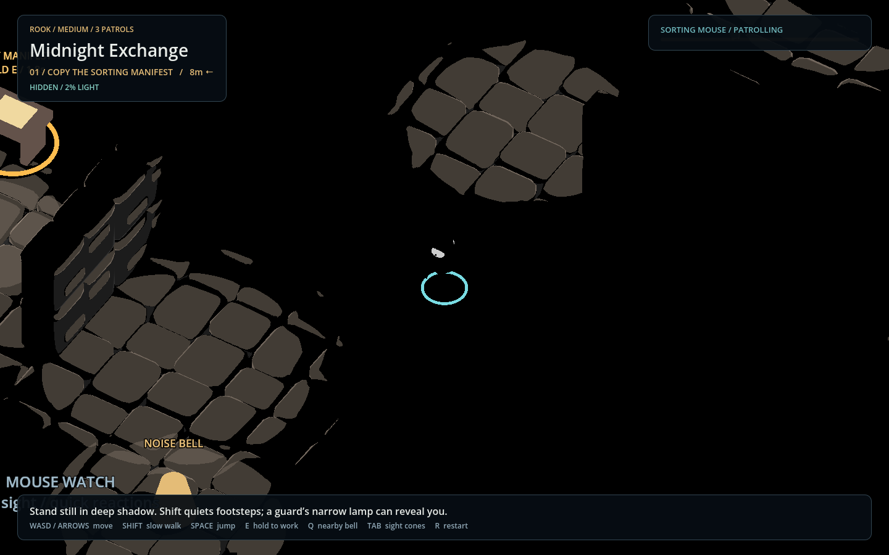
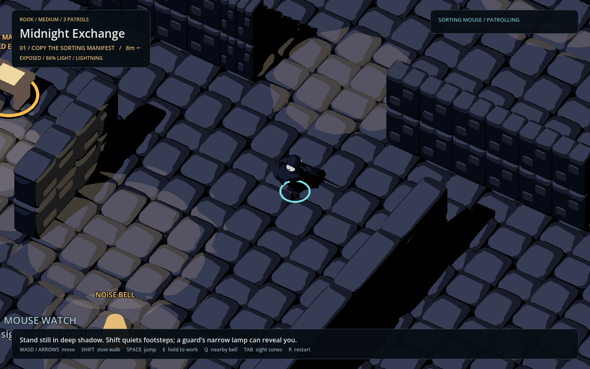

# Guard awareness: light, shadow, sound, and memory

Implemented in **Midnight Exchange**. Open `Levels/MidnightExchange.tscn` in
Godot and press **F6**. Earlier demo, stealth-study, and harbor encounters retain
their original controllers and detection rules.

## What the player can rely on

**Standing still in deep shadow is safe from visual recognition at ordinary
distances.** Darkness does not merely slow an inevitable detection timer.
Moving in shadow can attract attention, and moving loudly can be heard. A
searching guard may turn its lamp onto the hiding place and reveal Rook.

Light alone does not alert a guard. Rook must also be in that guard's view,
with no solid obstacle between them. Equally, being inside the view cone alone
does not identify an unlit Rook. Very close contact is the exception: darkness
does not protect Rook when almost touching a guard, but a wall still does.

The exposure sensor classifies Rook as **HIDDEN**, **DIM**, or **EXPOSED**.
Exposure is a property of Rook's lighting, not a claim that any guard currently
sees him. The compact guard awareness bar and state label communicate that
threat. The simplified HUD shows the objective, alert, and controls; exposure,
lightning, and noise readouts have been removed.

## Same position, different illumination

Earlier gameplay captures with Rook in the same place, before the HUD was simplified. In the first view the
sensor reports HIDDEN at 2% exposure. During a real storm pulse it reports
EXPOSED at 86%. The view cone still determines whether any particular guard
can recognize him.





## The sensing layers

| Layer | Shape or source | What it tells a guard |
| --- | --- | --- |
| Hearing | Radius limited by both sound loudness and hearing range | An event occurred at a location |
| Potential vision | Broad, long view cone | Where the guard could notice a figure |
| Guard lamp | Independently sized, narrower spotlight | Which parts of Rook receive this lamp's light |
| Other illumination | Nearby spotlights, omni lights, other guards' lamps, lightning | Which parts of Rook receive any gameplay light |
| Occlusion | Independent physics rays for light and sight | Whether a source actually reaches Rook, and whether a guard actually sees him |
| Memory | Last confirmed sighting, last sound, uncertain sighting | Where to pursue or investigate after contact is lost |

The important intersection is:

**Visual recognition = unobstructed guard view ∩ sufficiently illuminated Rook.**

Illumination combines all registered gameplay lights. One guard's lamp can
therefore reveal Rook to another guard. A spotlight behind a guard can light
Rook without granting that guard rear vision. Thunder and lightning do not
magically reveal Rook through walls.

There are two different obstruction questions:

1. **Light → Rook:** does the light reach the body sample? A wall can cast a
   shadow even when the guard has an unobstructed view of that position.
2. **Guard → Rook:** can the guard see the body sample? Rook can be brightly lit
   while remaining concealed behind solid cover.

## From evidence to behavior

The existing patrol, suspicious, chase, search, and return states are retained.
The new controller changes what evidence can move a guard between them.

| Evidence | Response |
| --- | --- |
| Stationary Rook in deep shadow, beyond close range | No visual awareness gain; existing awareness fades |
| Movement in shadow, or a dim figure | Limited suspicion, turn toward an approximate location, then investigate |
| Identifiable illuminated body samples | Build awareness toward pursuit; update the confirmed sighting position |
| Awareness reaches 100% | Pursue the confirmed position; capture requires current recognition and proximity |
| Recognition is lost during pursuit | Briefly continue, then search the last confirmed sighting |
| Audible footsteps, landing, or bell | Investigate the sound event's location without identifying Rook |
| Search expires | Navigate back to the patrol |

Shadow/dim evidence is capped at **35% awareness**. It cannot independently
start a chase. If existing awareness is above that cap, weak evidence lets it
fall toward the cap rather than instantly clearing it. After **0.8 seconds**
of uncertain evidence, a guard investigates a location rounded to a 1.5m grid
on the ground. That location is sampled once per uncertain episode, not updated
every frame. A guard can subsequently identify Rook if its moving lamp or a
world light provides stronger evidence.

Recognition increases awareness according to elapsed time, illumination,
distance, and central versus peripheral vision. A bright, nearby figure in the
center of view is recognized faster than a dimmer, distant figure at the edge.
There is no instant awareness bonus for entering a beam or receiving a flash.

After losing recognition, the guard does not receive Rook's exact hidden
position. It searches its last confirmed sighting. Neither sound nor uncertain
movement overwrites that confirmed memory.

## Illumination and partial cover

`StealthExposureSensor` samples two points, **0.10m and 0.55m above Rook's root**,
representing lower torso and head. The root is already above the floor; these
are relative offsets, not world heights.

For each sample, the sensor checks registered lights:

- Spotlights: range, actual beam direction, cone angle, angular falloff,
  energy, distance falloff, and a ray toward the light.
- Omni lights: range, energy, distance falloff, and a ray toward the light.
- Directional storm light: actual direction and current tweened energy, with
  a ray toward the source direction. Roofs and shelter can block it.
- Hidden, zero-energy, and negative lights: no revealing contribution.

Contributions add, capped at 1 per sample. The mean of the two samples gives
the gameplay exposure. The starting bands are:

| Exposure | Sensor state | Visual effect |
| --- | --- | --- |
| 0–12% | HIDDEN | Stationary Rook supplies no visual evidence |
| Above 12%, below 30% | DIM | Uncertain evidence; suspicion only |
| 30% or higher | EXPOSED | Recognition is possible if the guard can see enough of Rook |

Each guard separately tests sight to each sample. An occluded body part
contributes zero evidence for that guard. A visible, fully lit head with an
occluded torso gives 50% visual exposure and slower recognition than a fully
visible body. The sensor may still report fully exposed when a wall conceals Rook
from a particular guard: illumination and guard sight are intentionally separate.

This is an analytic gameplay exposure model, not a readback of screen pixels.
The toon shader's rim, emissive decorations, and material colors do not expose
Rook. The real light transforms, cone/range settings, energy, and collision
geometry provide the gameplay inputs. Midnight Exchange's registered fixtures
cast visual shadows too, so visible shelter and gameplay obstruction agree as
closely as the authored geometry permits.

## Hearing and movement

Sound arrives as a discrete event: position, audible radius, and kind.
The effective range is the smaller of the event radius and the guard's hearing
range. A blocked direct sound path multiplies this range by **0.75**. This is a
simple wall attenuation rule, not acoustic propagation around corridors.

| Sound | Event radius | Emission |
| --- | --- | --- |
| Normal footsteps | 5m | Each 1.2m of actual grounded movement |
| Shift footsteps | 1.6m | Each 1.2m of actual grounded movement |
| Landing | 7.5m | On landing after more than 0.15s airborne |
| Bell | Guard's hearing range | Q within 2.3m of a bell; nine-second shared cooldown |

Blocked movement does not generate footsteps. Standing still does not generate
a repeating sound. Footsteps are gameplay events; this change
does not add a new footstep sound asset. The bell retains its audible chime.

A guard investigating footsteps does not retarget to every subsequent footstep;
it checks the event location. A new bell can redirect an investigation. Sound
cannot override an active chase or a current identifiable sighting.

## Lightning

The actual `StormFlashLight` controls exposure through its current visibility,
energy, and direction. No separate artificial detection multiplier is applied.
A flash illuminates exposed Rook, and recognition can accumulate during its
bright portion. Repeated pulses contribute only through their actual duration.
As the light fades, shadow protection returns. Accumulated awareness fades
normally; a pursuing guard searches the last confirmed sighting.

Lightning leaves sight range and field of view unchanged. Solid cover still
blocks guard sight, and overhead shelter can block the illumination itself.
The existing storm timing, restrikes, thunder, and visual treatment are retained.

## Starting encounter tuning

| Setting | Hound | Mouse |
| --- | --- | --- |
| View range / full angle | 10m / 100° | 8m / 110° |
| Lamp range / full angle | 7m / 40° | 5m / 32° |
| Hearing range | 14m | 9m |
| Base detection time at recognition strength 1 | 1.2s | 0.85s |
| Close recognition radius | 1.25m | 1.25m |
| Pursuit contact-loss delay | 0.65s | 0.65s |
| Search duration after arrival | 6s | 6s |

Godot's `spot_angle` is a **half-angle**; the exported lamp FOV is a full angle.
The controller converts between them. Debug sight cones show potential vision,
while the actual lamps show illumination. Tab toggles the debug cones without
turning lamps off. A lampless guard can use external light or close recognition.

These values preserve the existing medium puzzle while adding useful shadow
routes. A coarse static night scan found 136 hidden, 6 dim, and 84 exposed
walkable sample positions with the guards at their initial poses. This is a
coverage check, not an area measurement or a human difficulty assessment.

## Implementation and authoring

- `scripts/stealth_exposure_sensor.gd`: shared two-sample illumination queries;
  runs before the guards each physics frame and caches exposure for all of them.
- `scripts/layered_stealth_guard.gd`: independent lamp and sight settings,
  recognition strength, capped uncertainty, hearing, and separate memory targets.
- `scripts/exchange_guard.gd`: encounter-specific patrol countdowns and bell API;
  extends the new layered controller.
- `scripts/exchange_player.gd`: emits footsteps from resolved movement and a
  separate landing event, while retaining the following camera.
- `scripts/midnight_exchange.gd`: routes sound events and displays exposure/noise.
- `scripts/midnight_exchange_builder.gd`: saves the sensor and registered light
  groups, enables visual fixture shadows, and authors the separate sense ranges.

To use the system in another level:

1. Add an `ExposureSensor` child to Rook using `stealth_exposure_sensor.gd`.
2. Use `layered_stealth_guard.gd` or a subclass for guards. Set their player,
   route, and exposure-sensor paths. Supply the same visual/animation wrapper
   expected by `StealthGuard`.
3. Add revealing Light3D nodes to the persistent **stealth_lights** group. Enable
   appropriate rendered shadows and author matching collision blockers on layer 1.
   Keep decorative lights out of the group. Newly spawned lights require calling
   the sensor's `refresh_lights()` after registration.
4. Connect player sound events to each guard's
   `hear_sound(position, audible_radius, kind)` method.
5. Tune view, lamp, hearing, exposure thresholds, and awareness timing separately.

Each light can optionally set `stealth_strength` metadata to scale its gameplay
contribution. Default strength is 1. Samples and obstruction masks are exported.
Keep visual and collision cover aligned when authoring; the physics queries do
not inspect rendered triangle shadows or indirect illumination.

## Verification

Run after Godot has imported the project:

```sh
godot --headless --path . --fixed-fps 60 --script tests/test_guard_awareness.gd
godot --headless --path . --fixed-fps 60 --script tests/test_awareness_integration.gd
godot --headless --path . --fixed-fps 60 --script tests/test_midnight_exchange.gd
godot --headless --path . --fixed-fps 60 --script tests/test_stealth_guard.gd
```

The focused awareness suite has 37 checks, and the saved-scene integration suite
has 9. They verify physics occlusion, both body samples, deep-shadow protection,
partial cover, elapsed-time accumulation, lamp separation, shared lamps, real
storm pulses, hearing attenuation, quiet input, landing events,
and frozen sighting memory. The 43-check Midnight Exchange suite
exercises patrols, the full physical route, objectives, live Hound kiting,
extraction, restart, and actual mouse capture. The original stealth and harbor suites each pass their 31 checks, confirming
that earlier detection behavior remains intact.

Rebuild the saved encounter with
`godot --headless --path . --script tools/build_midnight_exchange.gd`.
This replaces `Levels/MidnightExchange.tscn`; preserve hand-edited variants under
another name. For GPU views, run `tools/preview_midnight_exchange.gd` without
`--headless`. Existing macOS certificate and storm-resource shutdown messages
can appear despite passing assertions.
