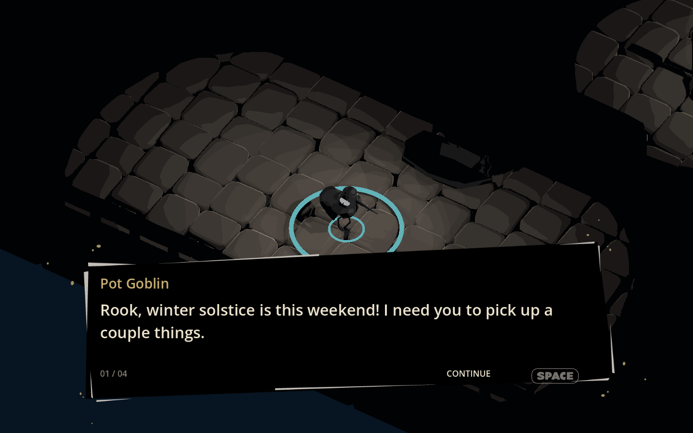
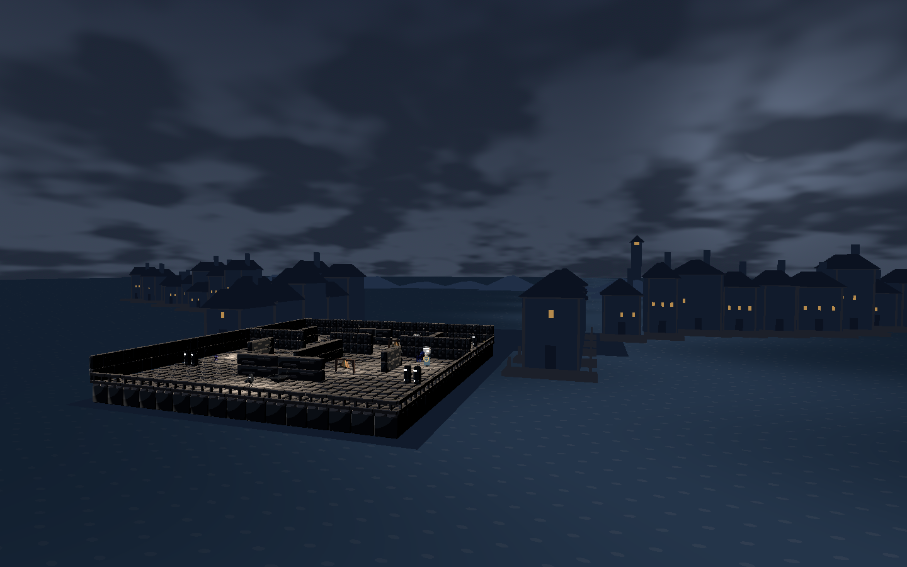

# Midnight Exchange

Open `Levels/MidnightExchange.tscn` in Godot and press **F6**. This is a new,
editable level; the existing demo and harbor scenes remain available.

Move with WASD/arrows, slow walk with Shift, jump with Space, hold E to work at
the current objective, and press Q near a gold bell to make a distraction.
Tab cycles **HUD only → HUD + guard vision → guard vision only → everything hidden → Styled HUD**,
then returns to HUD only (the default). Hidden HUD includes all screen panels,
result messages, floating labels, player/objective/exit rings, and bell pulses. Guard
vision includes diagnostic sight cones and search markers. Tab still works after
a win or capture, so hidden results can be revealed. R restarts. The objective display gives a
distance and a direction relative to the camera. The full HUD keeps only that
objective line at the top left, a suspicion eye and guard caption at top center,
and a single controls line at the bottom. **Styled HUD** shows only the suspicion
eye and the coin counter, using the hand-drawn artwork. Coin pickups update the
counter even while another display mode is selected. The result panel appears
in either HUD option when a run ends; Styled HUD hides world labels and markers.

## Encounter

The 32 × 34 metre exchange has a protected arrival court, separate sorting and
crank wings, two doors into the vault gallery, and solid screens that make
circuits for escaping pursuit. There is no global deadline. The medium
challenge comes from choosing an opening and spending time exposed at a task.

1. Copy the west-wing manifest: hold E for 1.8 seconds while the sorting mouse
   looks away. Its two-second pauses display a countdown.
2. Release the east-wing vault crank: hold E for 2.2 seconds. The Hound's whole
   normal circuit stays within five metres of the crank, so waiting for the
   patrol alone does not clear it. Ring the east bell, go around the screen's
   north end, and work the crank while the Hound investigates the south side.
   A sighting and pursuit can also draw it away; break sight before working.
3. Recover the night seal: hold E for 2.6 seconds. The vault mouse circles a
   central screen; time its turn or use the gallery bell to move it.
4. Return to the blue arrival circle with no guard seeing or chasing Rook.

Work resets when E is released, Rook leaves, a guard sees Rook, or a chase is
active. Completed stages persist for the current attempt. Rook can recover
from a sighting by breaking sight and moving away from the last seen position.

## Mouse guards and distractions

Both mice use the existing Mouse_v2 model and animations with the opt-in guard
controller. Compared with the Hound they have shorter sight (8m versus 10m), a
wider field of view (110° versus 100°), and faster detection (0.85s versus 1.2s).
Their view cones are wider and longer than their separate lamp beams. Deep shadow
protects stationary Rook, while movement and footsteps can trigger investigation.
They can pursue and catch Rook, investigate sounds, search, and rejoin their
ordered patrols. Their patrols move at 1.65m/s, with a 3.15m/s chase; Rook moves
at 4.2m/s. Solid cover blocks real sight rays as well as the lamp feedback.

The three bells use the rigged bronze asset in `Mesh/Bell/bell.tscn`; its bell
and clapper swing independently when struck (see [the asset guide](bell.md)).
Bells require Rook within 2.3m. A strike has an audible chime and an expanding
ring. Idle guards within hearing distance investigate the bell for six seconds
on arrival, then return. A bell cannot override a confirmed sighting or chase.
The shared nine-second cooldown prevents repeatedly pinning a guard in place.

## Camera and lighting

The orthographic camera follows smoothly with modest movement lead. Its size
is 9.4, tighter than Demo_A2's 10.286; orientation stays fixed so movement remains
consistent while the camera follows Rook. The HUD's direction cue uses this
same orientation.

The builder copies Demo_A2's environment, disabled steady directional light,
paired omni fixtures, white spotlights, and exact storm/thunder script and
assets. Fixture energy, falloff, and cone settings are preserved; fixtures now cast
shadows so illumination obstruction is visible. The diagonal
spotlights are positioned to land their pools on the new objectives and routes.
The storm shadow distance covers the larger footprint. Lightning changes exposure wherever its light reaches Rook. Recognition requires
illumination, guard view, and unobstructed sight. See the
[awareness system document](guard-awareness.md) for the complete rules and tuning.

## Source and checks

The scene is saved geometry, not a level generated during play. Edit it in
Godot, or regenerate it from `scripts/midnight_exchange_builder.gd`:

```sh
godot --headless --path . --script tools/build_midnight_exchange.gd
godot --headless --path . --fixed-fps 60 --script tests/test_midnight_exchange.gd
```

Rebuilding replaces only `Levels/MidnightExchange.tscn`; save a hand-edited
variant under a different name first. The new scripts extend the existing
stealth controllers without changing the ambient NPCs or earlier encounters.

The 49 integration assertions exercise all five display modes, styled coin
collection, frozen eye feedback, and hidden results,
saved-scene navigation, every patrol
corner, physical movement through the full route, real mouse vision and
capture, ordered/interruptible work, a physical kite around the live Hound,
noise investigation and cooldown, extraction, restart, and camera following.
They do not establish a human difficulty rating; medium is the intended tuning
and should be refined with playtesting. Godot may print the existing macOS
certificate and storm-resource shutdown messages despite passing assertions.

To render four gameplay views and a shadow/lightning comparison into `/tmp/midnight-*.png`, use a real renderer:

```sh
godot --path . --audio-driver Dummy --script tools/preview_midnight_exchange.gd
```

## Reference

[The WereCleaner App Store feature](https://apps.apple.com/ca/iphone/story/id1747961948)
describes visible pause timers, throwable distractions, and a brief opportunity
to break sight. This encounter adapts those ideas to Rook through deterministic
pause countdowns, reusable noise bells, short exposed tasks, and cover loops.
The game's cleaning/combat systems are not part of this level.


### Opening dialogue HUD test

Opening Midnight Exchange plays the four-line Pot Goblin / Rook winter-solstice
exchange using `UI/DialogueBox.tscn`, including the existing ink panel, edges,
splatter and Space key art. The reusable `scripts/dialogue_box.gd` controller
adds warm cream text, gold/cyan speaker colors, a soft pop-in, punctuation-aware
text reveal, a pulsing advance prompt and a short fade out. The panel fits the
viewport width and stays anchored near the bottom.

**Space or Enter** reveals the current line; press again to advance. The last
line stays until the player dismisses it. Gameplay, guards, storm and the run
clock pause during the exchange; gameplay HUD panels and world labels return
after closing. The opening replays on restart. Set `play_opening_dialogue` to
`false` for gameplay-only tests or previews. Dialogue data is the typed
`OPENING_DIALOGUE` array in `scripts/midnight_exchange.gd`.

Run `godot --headless --path . --script tests/test_opening_dialogue.gd` for
input, exact text, pause and resume checks. Run the same command without
`--headless`, adding `-- --preview`, to save rendered line and small-window
previews to `/tmp/midnight-dialogue-*.png`.



### Harbor establishing shot

The opening now starts with a seven-second perspective long shot: a slow dolly
across the exchange quay toward the harbor skyline, lighthouse and storm clouds.
Space, Enter or Escape skips directly to the existing opening dialogue; that
keypress is consumed. The shot hides HUD and objective markers and pauses Rook,
patrols and the encounter clock. It then cuts to the unchanged orthographic
camera for dialogue and gameplay. A temporary cool fill light reveals the quay
only during the shot and is removed before dialogue.

`play_establishing_shot` disables just the camera opening, and
`establishing_shot_duration` adjusts its duration. `play_opening_dialogue = false`
skips the entire opening for gameplay tests and previews, as before. Restart
replays the opening.

`scenes/backdrops/HarborBackdrop.tscn` supplies deterministic, batched low-poly
warehouse silhouettes, timber quays, islands, lighthouse and a water plane.
Its decorative meshes have no collision, navigation, shadows or real window
lights. They use rendering layer 2 so encounter lamps do not illuminate them.
The level installs its own procedural night-sky material without changing shared
environment resources or the existing ambient-light settings. This is a first
geometry pass; the concept art's detailed facades are not production assets.
The builder includes the backdrop so regenerating the level retains it.

```sh
godot --headless --path . --script tests/test_establishing_shot.gd
```

Run with a real renderer and `-- --preview` to save the first and last frames
as `/tmp/midnight-establishing-0.png` and `/tmp/midnight-establishing-1.png`.
The checks cover the dedicated camera, paused actors and clock, hidden HUD,
non-colliding backdrop, natural completion, skip input and dialogue handoff.



Verification: the 49 encounter assertions, opening-dialogue checks and both
establishing-shot paths pass. The Metal preview also emits renderer geometry/light
unpairing errors when the test removes each entire level, plus the existing
shutdown resource warnings; no shader or script errors occurred during playback.

### Moving cloud layers

The harbor sky now composites three independently drifting cloud layers: a slow
far bank, a middle layer moving across it, and faster overhead clouds that fade
near the horizon. Tune `far_cloud_velocity`, `middle_cloud_velocity`,
`near_cloud_velocity` and `cloud_motion_speed` in
`Materials/harbor_sky.gdshader`; setting the multiplier to zero freezes motion.
Godot's shader time continues while gameplay is paused for the opening.

The effect uses five procedural noise samples per visible sky pixel and adds
no cloud meshes, textures, lights or shadows. The cubemap pass uses a constant
color, realtime sky processing is explicit, and sky reflections are disabled;
the encounter retains its existing ambient-light source. Actual GPU cost still
depends on resolution and hardware and has not been benchmarked.

Run `godot --path . --audio-driver Dummy --script tools/preview_harbor_clouds.gd`
with a real renderer for a four-second fixed-camera comparison. It saves
`/tmp/midnight-clouds-0.png` and `/tmp/midnight-clouds-4.png` and checks that the
sky changes while camera motion, gameplay and the encounter clock stay paused.

### Blender modeling reference

`art/MidnightExchange/MidnightExchange_Workspace.blend` contains the saved level
and harbor as locked references, a separate collection for new objects and an
embedded GLB export helper. See [the Blender workspace guide](midnight-blender-workspace.md)
for modeling, export and Godot placement instructions.

### North quay warehouse

The reusable **NorthQuayWarehouse** exterior now stands beyond the north wall at
`(-7, 0, -24)`. It uses all five new stone Architecture components, with timber
framing, warm windows, loading doors and a slate roof. Its collision stays outside
the courtyard, and its windows add no gameplay lights. See [the warehouse guide](stone-warehouse.md)
for the editable Blender source, Godot scene and verification commands.

## Interaction polish and artist workbook

Midnight Exchange is the project startup scene again. HUD and Styled HUD modes
show a bottom-center prompt near a station or bell. Prompts include the action,
hold percentage, prerequisite, guard-clearance reason, or bell cooldown. Keyboard
and controller labels follow the last input device. Actions and prompts both
require proximity and a clear ray through cover. Hidden HUD modes hide prompts.

Each station and bell receives a warm surface shimmer: a 0.75-second diagonal
sweep every five seconds. It respects depth, pauses with gameplay, and adds no
illumination or stealth exposure. Completed stations stop shimmering. Locked
stations still shimmer; proximity text explains their prerequisite.

The audio-alert artwork appears for 2.5 seconds when a guard accepts a sound
investigation: YOU WERE HEARD for Rook's noise, BELL HEARD for distractions.
Inaudible or rejected sounds do not trigger it. Both HUD styles receive events.
The eye remains visual suspicion/chase/search feedback; hearing alone does not
fill it. The audio icon reports an event, not the duration of the guard's search.

`art/MidnightExchange/MidnightExchange_Interactables.blend` contains all six placed
props as editable collections, in metres, with motion previews and START HERE text:

| Object | Job | Moving part during use |
| --- | --- | --- |
| Manifest | Copy manifest, 1.8 seconds | TurningPage lifts and tilts |
| Crank | Release vault mechanism, 2.2 seconds | CrankRotor turns wheel and crossbar |
| NightSeal | Recover target, 2.6 seconds | Seal rotates and rises; disappears on completion in-game |
| Bell_0, Bell_1, Bell_2 | Distract guards | Existing animated bell and clapper |

The seal uses coin artwork but cannot auto-collect as an ordinary coin. The
station controls its movement and completion. Interrupted station work resets
motion and progress; completed stages persist for that attempt.

This workbook is a snapshot, not a live link. Export and integrate replacements
deliberately, preserving moving-part pivots and the bell's Ring action. The three
bells share one design. Automatic extraction rings are not manually operated props;
there are no separate loose coins in this saved level.

Rebuild exports with `godot --headless --path . --script tools/export_exchange_interactables.gd`,
then run Blender with `--python tools/build_exchange_interactables.py`. The builder
refuses to overwrite an existing workbook unless passed `-- --replace`; preserve
artist edits first.

Focused verification: `godot --headless --path . --fixed-fps 60 --script tests/test_exchange_polish.gd`.
With a native renderer, append `-- --preview` to capture `/tmp/exchange-polish.png`.
