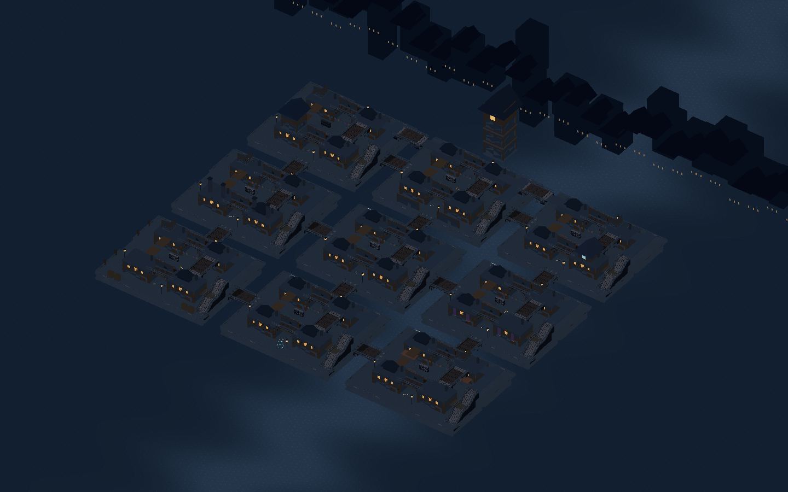
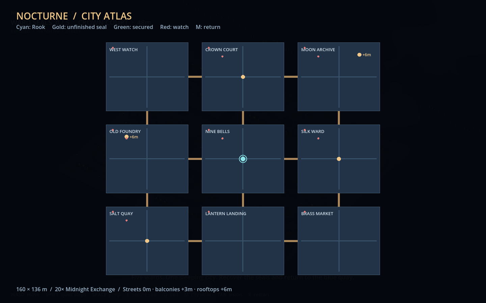

# Nocturne City

Open `Levels/NocturneCity.tscn` in Godot and press **F6**.

The playable city spans **160 × 136 metres (21,760 m²)**, exactly **20 times
Midnight Exchange's 32 × 34 metre footprint**. This compares horizontal bounds,
including canals; it does not mean twenty times the length in each direction.
The original level and project startup scene remain available.

Explore nine districts: Salt Quay, Lantern Landing, Brass Market, Old Foundry,
Nine Bells, Silk Ward, West Watch, Crown Court and Moon Archive. The islands are
48 × 40 metres, separated by real eight-metre water gaps. Twelve street bridges
join the districts. Two northern skybridges connect the rooftop network across
the canals. Every district has two stair flights, a +3m balcony, +6m roofs,
three internal wooden roof bridges, and an optional 1.8m broken crossing that
Rook can jump. Southern watch and archive towers, foundry flues, market cloth,
cargo stacks, civic arches and the distant bell tower distinguish the wards.

Recover **five ward seals in any order**, then return to the blue extraction
ring at Lantern Landing without being seen or pursued. Two seals are on roofs.
Hold E uninterrupted for two seconds; releasing E, leaving, or attracting the
watch resets unfinished work. Completed seals persist after a fall. Falling
into a canal returns Rook to the last safe district center reached while clear
of pursuit. Capture ends the attempt; R starts a new night.

| Control | Action |
| --- | --- |
| WASD / arrows | Move relative to the camera |
| Shift | Quiet walking |
| Space | Jump |
| Hold E | Secure a nearby ward seal |
| Q | Ring a nearby watch bell |
| M | Open/close the city atlas; pauses Rook and guards |
| Tab | Show/hide guard vision diagnostics |
| R | Restart |

Fifteen guards use the existing Hound and Mouse models and layered stealth AI:
nine street patrols and six roof patrols. Illumination, unobstructed sight,
movement in shadow, footsteps, landing noise, pursuit and last-known-position
searches retain the existing behavior. Bells draw nearby guards away from their
routes, with a shared nine-second cooldown. Confirmed pursuit overrides bells.
Warm street fixtures and guard lamps contribute to exposure; decorative windows
and the low moon fill do not. The existing moving cloud sky and thunder/lightning
cycle supply the night atmosphere.

The atlas marks districts, street crossings, watchmen, Rook and remaining seals,
including their rooftop elevation. The gameplay camera follows Rook's height. Buildings between Rook and the
camera fade so street routes stay readable.

## Art and construction

`tools/export_night_city_components.py` exports the eleven native architecture
masters from the current inventory and `ComponentLibrary/foundation.blend` into
`Mesh/NightCity/`. It retains the library's 4× scale and base-centered pivots;
building placements fit those masters to the city's bays. The export leaves
both Blender library copies and the authoring file untouched.

The saved scene uses the new plain, windowed, door, corner, broken arch and
second-story meshes, foundation and retaining pieces, existing harbor tiles,
railings, wooden bridges, staircase modules, grass, barrels, rigged bells and
Rook/NPC wrappers. Shared night materials adapt the native material slots to the
project's stone, timber and warm window palette.

Repeated artwork is stored in regional MultiMeshes. Navigation and simplified
collision are saved in the level, so play does not build geometry or bake
navigation. Whole actor branches, including skeletal animation, sleep beyond
52 metres unless chasing. Fixed lights fade with distance. These are structural
cost controls, not a benchmark or a guaranteed frame-rate target.

Re-export the native art if the source meshes change:

```sh
/Applications/Blender.app/Contents/MacOS/Blender --background --factory-startup --python-exit-code 1 --python tools/export_night_city_components.py
godot --headless --path . --editor --import --quit
```

Rebuild only this level with **a real renderer** (omit `--headless`):

```sh
godot --path . --audio-driver Dummy --script tools/build_night_city.gd
```

Godot's dummy headless renderer discards MultiMesh transform buffers during
serialization, so the builder rejects that mode. The result remains an ordinary,
editable saved Godot scene. Regeneration replaces `Levels/NocturneCity.tscn`;
save a hand-edited variant under another name first.

Run the integration checks and render previews:

```sh
godot --headless --path . --fixed-fps 60 --script tests/test_night_city.gd
godot --path . --audio-driver Dummy --script tools/preview_night_city.gd
```

All **63 integration assertions pass**. The checks exercise the saved navigation, every district and seal, physical
patrol circuits, both stair flights, roof and canal bridges, the jump gap,
distant actor sleep, atlas pause/resume, interactions, fall recovery, and escape.
The preview tool saves arrival, rooftops, canal, street, whole-city and atlas images to
`/tmp/nocturne-*.png`. Existing engine certificate/shutdown warnings can still
appear independently of test results. Human difficulty and desktop/web
performance still need playtesting.




