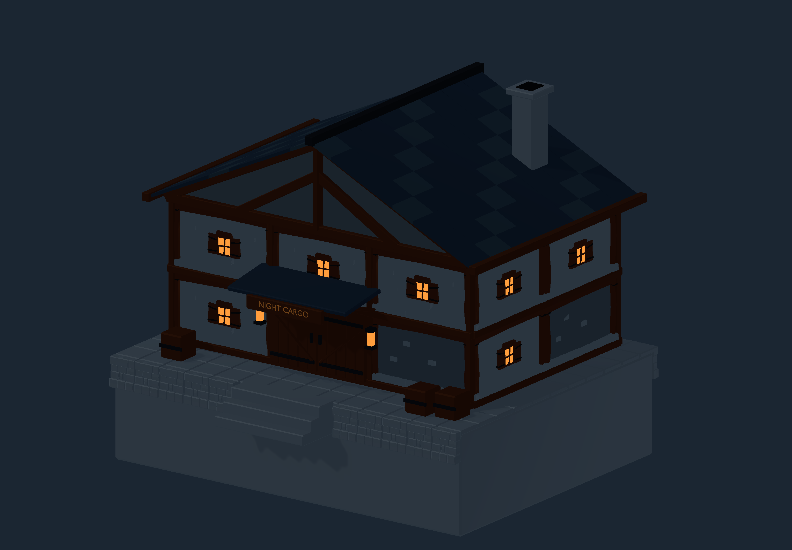

# North quay warehouse

`Levels/MidnightExchange.tscn` now instances **NorthQuayWarehouse** at
`(-7, 0, -24)`, beyond the north courtyard wall. It is a closed building exterior
beside the encounter: the existing objectives, entrances, cover and patrol routes
stay in place. The level builder includes the same instance when regenerated.

The two-story warehouse uses all five new Architecture components from the
Blender library: foundation, retaining wall, foundation corner, plain stone wall
and windowed stone wall. It adds a submerged stone quay, loading steps, timber
framing, closed double doors, a cargo sign, an awning, crates, a slate roof and
a chimney. Warm window and lantern surfaces are unshaded; they add no lights to
the stealth system.



## Edit and reuse

- Open `art/StoneWarehouse/StoneWarehouse.blend` to edit the assembly. Its five
  collections separate the plinth/quay, ground floor, upper floor, roof/timber and
  loading details. The main collection is marked as a Blender asset.
- Instance `Modules/Buildings/StoneWarehouse.tscn` in Godot to reuse the exterior.
  Its origin is at ground level, and its loading facade faces local **+Z**.
- In Midnight Exchange, select **NorthQuayWarehouse** in the scene tree and press
  **F** to frame it in the 3D editor. Run the level with **F6** to see it in context.

The saved Blender source retains **441 editable pieces**. Its GLB export bakes
those pieces into five section meshes with shared materials; the Godot wrapper
adds simplified solid building, quay and step collision. The palette is applied
by `Mesh/StoneWarehouse/stone_warehouse_materials.gd`, including in the editor.
The warehouse is not an enterable interior.

## Rebuild and check

```sh
/Applications/Blender.app/Contents/MacOS/Blender --background --factory-startup --python-exit-code 1 --python tools/build_stone_warehouse.py
godot --headless --path . --editor --import
godot --headless --path . --script tools/build_stone_warehouse.gd
godot --headless --path . --script tests/test_stone_warehouse.gd
godot --headless --path . --fixed-fps 60 --script tests/test_midnight_exchange.gd
```

The Blender builder checks each native component's world dimensions before
export. The warehouse checks cover the saved instance, geometry bounds, material
palette, physical sight obstruction, collision separation from the courtyard and
retention by the level builder. The encounter suite exercises the existing live
patrols, navigation, full player route and objectives.

Render the neutral inspection image, night placement, temporary inspection fill
and existing establishing-shot view with a real renderer:

```sh
godot --path . --audio-driver Dummy --script tools/preview_stone_warehouse.gd
```

The inspection image is saved to `docs/images/stone-warehouse.png`; the three
level views are `/tmp/midnight-warehouse-*.png`. Preview lighting is temporary.
The Midnight Exchange workspace exporter includes the warehouse in future
snapshots; the existing modeling workspace has not been overwritten.

Verification: the warehouse checks pass, and the encounter suite reports
**49 passed, 0 failed**. The rendered previews were inspected after correcting
component transforms, two-sided wall/glass materials and gable trim overlap.

The full editable assembly is also included as **Stone warehouse** in the main
component library under **04 Buildings**, with an embedded thumbnail and source
record. Both library copies contain 53 assets. Library rebuilds retain the warehouse.
